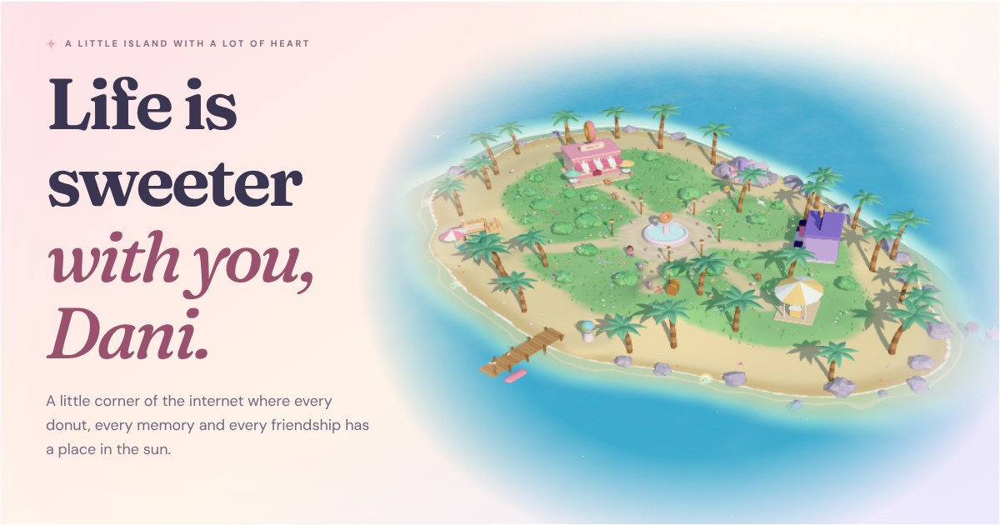

# 🍩 Dani’s Donut Island: Ultimate Edition

**A playable 3D island and a love letter for HeyDani, made by Dani’s Donuts.**
Walk around a pastel island, meet the Donuts, collect sprinkles, read notes in bottles, light six lanterns and open the grand finale under the fireworks. Then leave a note of your own.



It’s an unofficial, community-made gift. Every visual is original and drawn in code, with no official game art, licensed music or real community messages. The examples you see in Preview Mode are clearly labeled samples.

> **🚀 Launching it for real?** Follow **[GO-LIVE.md](GO-LIVE.md)**: every step to save everyone’s notes (Supabase), moderate them, and put the island on your own domain.

---

## What’s on the island

| | |
|---|---|
| **3D island adventure** | A real-time 3D island you walk around in third person. Use **WASD / arrow keys**, **Shift** to run, **Space** to jump and **E** to talk or enter. On phones, use the on-screen **joystick** or **tap to walk**. **Gamepads** work too, so it’s great on stream. Drag to turn the camera, scroll or pinch to zoom. Your progress is saved on your device. |
| **Six quests** | The Donut Shop, Memory Beach, Victory Arcade, Collector’s Corner, Crystal Cove and the Treasure Chest. Each one lights a lantern around the fountain, earns a treasure and moves the sky from morning through golden hour into **sunset**. |
| **The Donuts** | Every approved public note becomes a little **donut friend** who hops around the island in the frosting and sprinkles its author picked. Walk up to one to read their note. **Glaze**, the island guide, helps new players. |
| **Collectibles** | **40 sprinkles** to find, **messages in bottles** that wash up on the beaches (each holds a community note), and a **secret golden donut** on a tiny island you can only reach by jumping. |
| **Grand finale** | When all six lanterns glow, a gift rises from the fountain. Open it: night falls, **fireworks** burst over the sea, a **sky lantern rises for every person who wrote in**, and the letter to Dani appears. |
| **XP & trophies** | XP, 6 ranks (Sprinkle → Legendary Donut) and 12 trophies, including a secret one. |
| **Attractions** | Community Donut Box · Crystal of Kindness · **Booster packs with holographic, tilting cards** · Sunset Cinema (YouTube / MP4) · Donuts Around the World · Donut Diaries · **Sprinkle Hunt** (memory game) · **Donut Drop** (60-second arcade game). |
| **Leave a note** | The form shows a **live preview of your Donut**: pick its frosting and sprinkles, a crystal for open-when letters, a card theme for trading cards, and an optional continent. Drafts save automatically. |
| **Organizers** | Moderation (pending / approved / rejected), plus **Hide / Delete buttons on every note** while signed in. Also edition settings, **open the surprise**, private JSON export, publish an edition to the Diaries and **trigger the live OBS finale**. |
| **Live updates** | Open pages notice when the organizers open the surprise and when new notes are approved, so viewers don’t need to reload. |
| **OBS overlay** | `obs-overlay.html`: a transparent finale (raining donuts, sprinkles, fireworks and the title card) plus an optional **rotating love-notes lower third**. |
| **Sound** | Everything you hear is synthesized live in the browser: waves, a soft pad, footsteps, splashes, Donut “voices”, chimes and fireworks. There’s a sound toggle in the header and in the game. |

It respects **reduced motion**, works with the keyboard and screen readers, falls back to the 2D island map when a device can’t run 3D, lowers 3D quality automatically on weaker devices, and pauses rendering whenever the island is hidden.

---

## 1 · Go live on GitHub Pages

The repo already includes the deploy workflow (`.github/workflows/deploy.yml`), the same setup as the first Dani’s Donuts site.

1. **Merge the pull request** into `main`.
2. In the repo, open **Settings → Pages** and set **Source** to **GitHub Actions** (you only do this once).
3. Every push to `main` now builds and deploys automatically. The site appears at
   **https://nickwinters1.github.io/DanisDonutsv2/**
   - Open **Actions → Deploy to GitHub Pages** to watch a deploy. You can re-run it there with **Run workflow**.
   - The OBS overlay is at **https://nickwinters1.github.io/DanisDonutsv2/obs-overlay.html**

Until you connect the shared database (step 3), the live site runs in **Preview Mode**: everyone sees the labeled sample notes, and anything they submit stays only in their own browser. A **Preview** label in the ribbon says so.

**Your own domain:** see [GO-LIVE.md → Part 5](GO-LIVE.md#part-5-your-own-domain). In short: add the domain under **Settings → Pages → Custom domain**, add GitHub’s DNS records at your registrar, tick **Enforce HTTPS**, and set `siteUrl` in **`src/live-settings.ts`** (e.g. `https://yourdomain.com/`) so link previews use it.

**Launch check:** after every deploy, every 3 days, and whenever you click **Actions → Check the live site → Run workflow**, GitHub checks the island, the OBS overlay, the database and your domain, and lists ✅ or exactly what to fix on the run’s **Summary** page. It only reads public information.

## 2 · Try it on your computer

You need [Node.js](https://nodejs.org) 20+.

```bash
npm install
npm run dev
```

Open the address it prints. Add `?quality=high`, `?quality=medium` or `?quality=low` to the URL to force a 3D quality level.

## 3 · Connect the shared island (Supabase, free tier)

Every click, step by step: **[GO-LIVE.md](GO-LIVE.md)**. In short:

1. Create a project at https://supabase.com/. In **Authentication → Users → Add user**, create your organizer login (email + strong password, **Auto Confirm**).
2. In the **SQL Editor**, run **`supabase/one-step-setup.sql`** once. It’s `setup.sql` + `upgrade.sql` + “make the first login the organizer” in a single all-or-nothing transaction, and it ends with **All set! *your email* is the organizer.** These set up the sealed edition, messages, organizer accounts, archives and **row-level security (RLS)**. (Already ran the original v1 `setup.sql`? Back up, then run only `upgrade.sql`.)
   - More organizers: create their login, then run `insert into public.island_admins(user_id) values ('THEIR-USER-UUID');`
   - Turn off public sign-ups (**Authentication → Sign In / Providers**); visitors never need accounts.
3. Copy the project **URL** and the **publishable key** (or legacy **anon public** key) from Project Settings. **Never use the service-role or secret key.** The site refuses to use one if it’s supplied by mistake.
4. Put both in **`src/live-settings.ts`** (on GitHub: ✏️ pencil → paste between the quotes → **Commit changes**). The site redeploys itself, and the ribbon now says **Community edition**. The site and the OBS overlay both pick up the same settings.
   - Prefer not to keep them in the code? Add Actions **Variables** `VITE_SUPABASE_URL` and `VITE_SUPABASE_ANON_KEY` instead (Settings → Secrets and variables → Actions → Variables) and re-run the deploy. Variables win over the file.

For local development, copy `.env.example` to `.env` and fill in the same two values.

The public key is designed to be public. **RLS is what protects the data**: visitors can only submit pending notes, and they only ever read approved **public** notes after the reveal.

**Moderation:** every new note waits in **Pending** until an organizer approves it. **Hide** (reject) takes a note off the island but keeps it; **Delete** removes it for good. Signed-in organizers also get Hide / Delete buttons right on each note. To publish notes instantly instead (you can still hide or delete them), run `supabase/optional-auto-approve.sql`; `supabase/optional-require-approval.sql` undoes it.

## 4 · Running the celebration

1. Share the link privately with moderators first. Open **Organizer** (footer link, or add `#organizer` to the URL), sign in, and set the edition title and ID. **Leave “Open the surprise” unchecked.**
2. Test a submission from another browser. Confirm it shows as pending for organizers and **can’t be seen publicly**, even after approving it while the surprise is sealed. Check that private notes never appear publicly after the reveal, and test rejecting and editing too. Only then share the link with the community.
3. Before the event, moderators review and approve public messages. Check every link for appropriate content and permissions. **Private notes stay organizer-only even when approved**; deliver them to Dani privately. Don’t show the organizer view or the private export on stream.
4. **Reveal day:** tick **Open the surprise** and save. Pages that are already open notice within about 30 seconds and celebrate. Dani can open the link and click **Open the surprise**, or play the island all the way to the grand finale.
5. **Next anniversary or birthday:** export your archive, use **Publish this edition to the diary** if you want it kept publicly, then change the edition ID and title and uncheck the reveal. Use a new ID for every event, and never reuse an archived ID for a secret edition. To unpublish a chapter, delete its row from `island_archives` in the Supabase SQL editor (not the messages).

### Suggested community post

> We’re putting together a little surprise for Dani! 🍩 If you’d like to leave a message, favorite memory, clip, fan art or just a few kind words, visit [island link]. You can use your Twitch name or stay anonymous, choose whether your note is okay to show on stream, and even pick the frosting for your own little Donut who’ll hop around the island. Please keep it a surprise and only share the link with other Donuts who can keep the secret. ♡

## 5 · OBS overlay and Streamer.bot

1. In OBS, add a **Browser Source** with the full overlay URL, at **1920×1080**, above your scene. Its background is transparent. Keep the source active, and start it before the finale.
   - `…/obs-overlay.html` plays the finale whenever an organizer presses **Trigger live finale**. It checks every 2 seconds, runs for 14 seconds, and never replays an old signal when it starts up.
   - `?test` shows a **Test celebration** button and plays once, so you can preview it in a normal browser. Remove it for broadcast.
   - `?duration=20` changes the length. `?scale=0.8` changes the size of the title card.
   - `?mode=messages&every=12&pos=bl` shows a **rotating love-notes lower third** of approved public notes (only after the reveal). `pos` can be `bl`, `br`, `tl` or `tr`.
2. Once the surprise is open, an organizer opens the Organizer dashboard **off-camera** and presses **Trigger live finale** at the agreed moment. The finale chest on the public island never triggers broadcast effects; only organizers can.
3. **Optional: Streamer.bot.** On Dani’s streaming PC, set up Streamer.bot with its OBS integration. Enable its HTTP server on **loopback only** (127.0.0.1, port 7474 by default), and create an action named `Dani Island Finale` with the effects you want. **Don’t expose the HTTP server to the internet.** Then run the bridge from this repo with the same public settings:
   ```powershell
   $env:ISLAND_SUPABASE_URL = 'https://YOUR-PROJECT.supabase.co'
   $env:ISLAND_PUBLIC_KEY = 'YOUR-PUBLIC-PUBLISHABLE-KEY'
   $env:ISLAND_SB_ACTION = 'Dani Island Finale'
   $env:ISLAND_SB_PORT = '7474'
   python tools/streamerbot-bridge.py
   ```
   The bridge polls the public event state and calls Streamer.bot’s local `/DoAction` endpoint when it sees a new finale signal. It doesn’t open any inbound port, doesn’t replay old signals, and doesn’t retry a failed action (to avoid double effects). Stop it with Ctrl+C. See the [DoAction](https://docs.streamer.bot/api/http/requests/do-action) and [OBS sub-action](https://docs.streamer.bot/api/sub-actions/obs-studio) docs.

The overlay and Streamer.bot trigger independently, so exact timing varies a little with polling. Avoid excessive flashing, review all media, and test the sound volume before going live.

## 6 · Make it yours

- **`src/live-settings.ts`** connects the database and sets your domain for link previews (public values only).
- **`src/config.ts`** holds Dani’s links and **the finale letter** (please read it and make it yours).
- **`src/data/catalog.ts`** holds the six destinations, their prompts and treasures, the attractions, frostings, crystals, regions and card themes. Option keys must match the check in `supabase/upgrade.sql`.
- **`src/data/samples.ts`** holds the labeled Preview Mode samples. They never reach the database.
- **`index.html`** has the hero text, section headings and the surprise-reveal text.

## Preflight checklist

- [ ] From another browser, send a public decorated donut, a crystal letter, a trading card, a video link and an opt-in map message. Approve them while sealed and confirm non-admins can’t see them until the reveal. Confirm private and rejected items stay hidden, and that anonymous visitors can’t change moderation status or the finale signal.
- [ ] Open the surprise and test on desktop and mobile: all six quests, the Donuts, a bottle and the finale.
- [ ] Test the OBS overlay with `?test`, then with a real signal, and test the Streamer.bot bridge on the streaming PC. Rehearse the reveal before the broadcast.

## Limitations

- Contributions are text plus optional **HTTPS links** (photos, clips, fan art, videos). There are no direct uploads, and links only open when clicked. Linked sites can see a viewer’s network information when opened.
- The Treasure Chest collects future wishes. It isn’t a timed vault, so deliver anything truly future-only privately.
- The organizer login lives in memory: reloading signs you out. Expired sessions refresh automatically once.
- In Preview Mode the reveal and organizer tools aren’t secure; they exist so you can test locally.
- For a large or public community, add server-side **CAPTCHA / rate limiting** before sharing widely. The form only has a honeypot and moderation. Consider an edge function with CAPTCHA validation, and revoke the public insert privilege once it’s installed. Supabase’s default REST row limit may cap very large collections.
- Game progress (quests, sprinkles, trophies) is saved per device. The island is single-player.
- No hosted project, real community data, video uploads, verified Twitch login, lighting setup or OBS connection is provisioned here. The overlay and bridge are ready to configure.

## Where the secrets are (spoilers!)

<details><summary>Show me</summary>

- **The golden donut** is on the little island east of the Card Shop. Wade out from the east beach and **jump** across the three stepping stones (Space, ✦/⤒ on touch, X on a controller). Falling in just sends you back to the beach.
- **Bottles** wash up in the shallows all around the island and reappear somewhere new after you read one.
- **Sprinkles** line every path. A few hide behind buildings, at the end of the dock, on the treasure hill and on the stepping stones.
- On the page, try **↑ ↑ ↓ ↓ ← → ← → B A**.
- After the finale the island stays a starry night. The pause menu can bring the daytime back.
</details>

---

## Tech

Vite + TypeScript with no UI framework. **Three.js** renders the island: procedural terrain, a lagoon water shader driven by a heightmap (shallows, depth colour, rolling foam, glitter), a time-of-day sky, instanced flowers, grass and sprinkles, swaying merged palms, and particles for fireworks, splashes and sparkles. Everything is built in code, with no 3D models or textures to download. The 3D engine loads lazily after the page has painted, and rendering quality adapts to the device. The 2D island map is generated from the same geography as the 3D world. The two mini-games are Canvas 2D. Sound is Web Audio. Data is plain Supabase REST (PostgREST + Auth), so there’s no SDK. Fonts are self-hosted: Fraunces, DM Sans and Fredoka. The production build ships a Content-Security-Policy that only allows the site itself, your Supabase project and youtube-nocookie embeds.

```
index.html, obs-overlay.html   the two pages
src/
  config.ts                    links, the finale letter, Supabase settings (from env)
  main.ts                      page boot, events, live polling, opening the island
  data/                        catalog, samples, store (Preview Mode + Supabase), REST client
  game/                        the 3D island
    layout.ts                  geography: coastline, heights, places, paths, colliders, collectibles
    world/                     terrain, water, sky, props, landmarks, collectibles
    actors/                    the avatar, the Donuts, the donut recipe
    systems/                   movement, input, A* pathfinding
    fx/                        particles, fireworks, sky lanterns
    hud.ts, quality.ts, index.ts
  ui/                          dialogs, notes wall, form, organizer, attractions, games, reveal, island map
  art/                         procedural SVG donuts, crystals and illustrations
  overlay/                     the OBS overlay
  lib/                         progress (XP, trophies), sound, storage
supabase/setup.sql, upgrade.sql
tools/streamerbot-bridge.py
```

Made with love by Dani’s Donuts. A fan-made community gift, not affiliated with Twitch, Pokémon, Fortnite or any other game, platform or brand mentioned.
